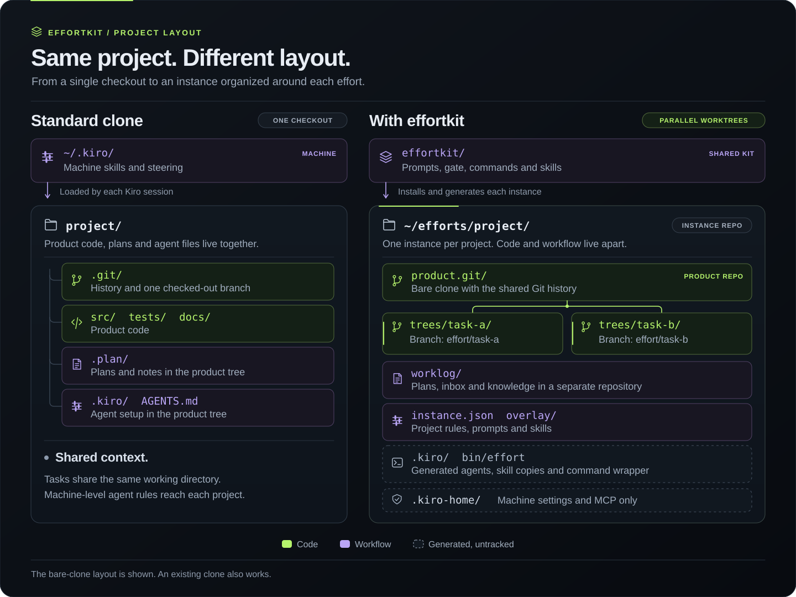

# effortkit



effortkit is an agentic workflow for kiro-cli.
You can deploy it to any software project.

## Purpose

- effortkit lets a team of AI agents do software work in a project.
  One person, the owner, controls the work.
- Each unit of work is an effort.
  An effort has a plan folder, a branch and its own git worktree.
- A supervisor agent runs the efforts.
  It gives each task to a specialist agent: an explorer, a researcher, a planner, a developer, a tester, a reviewer, a debugger or an improver.
- The agents can work on many efforts at the same time.
  The agents of one effort change only the worktree of that effort.
- The owner approves each plan before an agent changes the code.
  A changed plan needs a new approval.
- A gate checks every tool call before the call runs.
  The gate refuses a call that:
  - writes outside the folders of the agent,
  - pushes to a remote,
  - discards work, for example `git reset --hard`,
  - reads a credential file.
- The agents never push.
  The owner pushes, and opens the merge request or the pull request.
- The workflow has an improvement loop.
  - The agents write a note about each problem that the workflow causes them.
  - The gate records each refusal.
  - An improver agent reads these records.
    Then it writes a plan for a fix.
  - The owner approves the plan.
    Then a developer agent makes the change.
- One kit serves many projects.
  The kit holds the generic rules, the agent prompts and the skills.
  Each project adds its own rules in one configuration file and one overlay folder.
- Each project keeps its own copy of every skill that its agents use.
  Thus the project works the same on every machine.

## Words

- **Kit**: this repository. It holds the rules, prompts, skills and commands that every project shares.
- **Instance**: one deployment of the kit for one project. Its folder holds `instance.json`, the overlay, the worklog and the trees.
- **Overlay**: the rules of one project: project steering, rules for one role, and project skills.
- **Effort**: one unit of work. It has a plan folder, a tree (a git worktree) or no tree, a branch and a supervisor session.
- **Kind**: the type of an effort: `code`, `review`, `triage`, `kit` (a change to the kit) or `overlay` (a change to the instance).
- **Note**: one file in the inbox. A `fact` note holds a fact about the project. A `workflow` note says what made the work slower or worse.
- **Improvement round**: an effort of kind `kit` or `overlay`. In it, the improver triages the workflow notes and plans the fixes.

## Requirements

- Linux, Python 3.9 or later, git and kiro-cli.
- Optional: tmux for stages in the background, rg for searches, and npx for the review pages.
- `effortkit doctor` checks these tools.

## Set up a new project

Once per machine, from the folder of the kit:

```bash
bin/effortkit setup      # links effortkit into ~/.local/bin, then runs effortkit doctor
```

`effortkit doctor` checks Python, git, the kiro-cli version and login, tmux, rg, npx, commit signing, the kit skills and every registered instance.

Then set up the project with the installer agent:

```bash
effortkit installer ~/efforts/<name>
```

The installer runs `effortkit init`, shows every setting with its evidence, and asks only what the repository cannot show.
Then it installs the instance and writes the project steering.
It writes only in the target folder and in `/tmp`, and every command that changes something asks you first.

Or set up the project without the agent, in two steps:

```bash
effortkit init <git-url-or-clone> --out answers.json    # detects the settings and prints the evidence of each
effortkit install --dir ~/efforts/<name> --config answers.json
```

`effortkit init` finds the default branch, the commit and ticket convention, the branch naming and the test commands.
It also finds the tree setup and the commands that publish.
Review the answers before the install.
`docs/config.md` describes every setting, and `effortkit check <dir> --validate` checks an instance.

Then put the instance command on PATH under a name of your choice:

```bash
ln -s ~/efforts/<name>/bin/effort ~/.local/bin/<name>-effort
```

## Run an effort

1. `effort home` opens the home chat, which serves every effort.
   `effort start <name>` opens the chat of one effort.
2. Create the effort, or let the home chat do it: `effort new <name> --kind code [--ticket <key>]`.
3. Say what you want. The supervisor sends the explorer, the researcher and the planner.
   The planner writes `task.md` and `questions.md`. The supervisor can show them as a review page.
4. Approve the plan in the chat: `!effort approve <name>`. Only you can do this.
   A changed `task.md` needs a new approval.
5. The supervisor sends the developer, the tester and the reviewer.
   Each wave ends with a local commit. The agents never push.
6. You push, and open the merge request.
   After the merge, the supervisor merges the fact notes of the effort into the knowledge.
   Then you run `effort close <name>`.

Inside the chats, `effort` is the command of the instance, because the session puts the `bin/` folder of the instance first on PATH.

## Commands

| Command | What it does |
|---|---|
| `effort status [--collisions]` | The open efforts: stage, approval, live session, runs and branch. The open notes of the inbox. |
| `effort new <name> --kind <k> [--base <ref>] [--ticket <key>] [--branch <b>]` | A plan folder, a tree and a branch. An existing `--branch` continues that branch. |
| `effort start <name>` / `effort home` | A supervisor chat. `--resume` continues the last chat. `--terse` asks for short replies. |
| `effort approve <name>` | Approves `task.md`. The owner only, in a terminal or with `!`. |
| `effort run <name> --role <r> --brief <file> [--detach]` | One headless stage. The supervisor runs this. |
| `effort wait <run-id>`, `effort logs <run-id>`, `effort attach <name>` | The results and the windows of the runs. |
| `effort close <name>` | Removes the tree and keeps the branch. For a round, it files the decided notes. |
| `effort report <text>`, `effort improve`, `effort improve stats` | Files a workflow note, starts an improvement round, shows the trend. |
| `effort find <words>`, `effort kb add <topic> <text>` | Searches the plans. Adds a fact note to the inbox. |
| `effort plan-review <name> [decision.md]` | A review page of the plan, or of the open decisions. |
| `effort preflight <name> [--fix]`, `effort gen [--check]` | Checks the effort, the hooks and the generated configs. |
| `effortkit setup`, `effortkit doctor [--instance <dir>]` | Puts effortkit on PATH once per machine. Checks the machine, the kit and the instances. |
| `effortkit installer <dir>` | The installer agent for a new project. |
| `effortkit init <repo> --out <file>`, `effortkit install --dir <dir> --config <file>` | Detects the answers of a new instance, with evidence, and installs it. |
| `effortkit check <dir> [--validate]` | Checks the config and the overlay of an instance. `--validate` also runs kiro-cli on the agent configs. |
| `effortkit instances`, `effortkit reports --scope kit` | Every registered instance, and the open kit notes across them. |
| `effortkit skills [lock]`, `effortkit mcp-servers` | The shipped skills with their sources and licences, and the MCP server names of this machine. |

## Safety

- The approval covers the exact `task.md`, by its hash.
- A write to a forge or through an MCP server is for the supervisor only, after the owner said yes.
- The gate also refuses the forbidden commands of the config, for example a deploy.
- The gate judges a shell command by its text. It stops mistakes, not a hostile agent.

## Tests

```bash
effortkit selftest      # or: python3 -m unittest discover -s tests -t .
```

The tests build temporary instances and a toy project in `/tmp`, and a fake kiro-cli stands in for the model.

## Changing the kit

- Use an effort of kind `kit` in any instance: `effort new <name> --kind kit`.
- Its tree is a worktree of this repository.
  Live sessions keep the merged version until you merge the change.

## More information

- `docs/guide.md`: the skills, the improvement loop, and the layout of the kit and of an instance.
- `docs/config.md`: every setting of a project.
